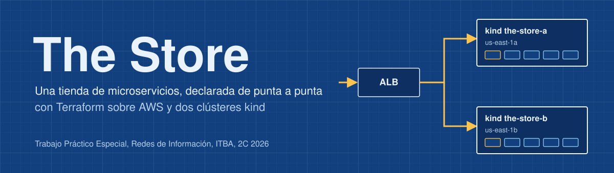
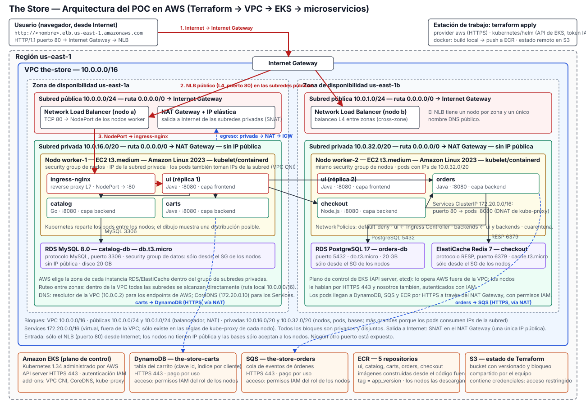

<p align="center">
  
</p>

<p align="center">
  
  
  
  
  
</p>

<p align="center">
  <a href="#arquitectura">Arquitectura</a> &nbsp;|&nbsp;
  <a href="#organización-del-código">Código</a> &nbsp;|&nbsp;
  <a href="#cómo-levantar-el-entorno">Cómo levantarlo</a> &nbsp;|&nbsp;
  <a href="#casos-de-uso">Casos de uso</a> &nbsp;|&nbsp;
  <a href="#destruir-el-entorno">Destruir</a>
</p>

The Store es una tienda online de cinco microservicios. Este repositorio la despliega en AWS solo con Terraform: `plan`, `apply` y `destroy`.

Terraform crea la red, el Application Load Balancer, las imágenes en ECR, dos EC2 privadas, los servicios de datos y los objetos de Kubernetes. Cada EC2 ejecuta su propio clúster kind con dos réplicas de cada servicio: **20 pods de aplicación en total**.

**Grupo 2:** Matías Rossi, Juan Pablo Birsa y Federico Viera. Trabajo Práctico Especial de 72.20 Redes de Información, ITBA, 2C 2026. El alcance está definido en la [pre-entrega](docs/preentrega-vigente.pdf).

## Arquitectura

<p align="center">
  
</p>

Un pedido entra por el ALB en HTTP 80 y llega al puerto 8080 de una EC2. El mapeo de puertos de kind lo pasa al NodePort 30080 de la UI, que lo entrega a un pod.

La UI llama a Catalog, Carts y Checkout, y Checkout llama a Orders. No hay otros caminos entre pods: las NetworkPolicies bloquean todo lo demás.

| Bloque | Uso |
|---|---|
| `10.0.0.0/16` | VPC |
| `10.0.1.0/24`, `10.0.2.0/24` | Subredes públicas: ALB y NAT Gateway de cada zona |
| `10.0.16.0/24`, `10.0.32.0/24` | Subredes privadas: EC2 con kind e interfaces del endpoint de SQS |
| `10.0.48.0/24`, `10.0.49.0/24` | Subredes de datos: RDS y ElastiCache, solo con la ruta local |
| `10.244.0.0/16` | Pods, interna de cada kind |
| `172.20.0.0/16` | Services, interna de cada kind |

Los dos clústeres son independientes: no comparten plano de control ni mueven pods entre EC2. Las réplicas de un kind comparten CPU y memoria de su host, así que no toleran la caída de esa instancia. La tolerancia entre zonas viene de tener una copia completa por zona, detrás del ALB.

## Organización del código

```text
terraform/
├── 1-bootstrap/      Bucket S3 del estado remoto
├── 2-infra/          Todo lo de AWS; valores en terraform.tfvars
├── 3-aplicacion/     Objetos de Kubernetes; casos de uso en terraform.tfvars
└── modules/          Recetas que usan las raíces
    ├── red/          VPC, subredes, NAT, endpoints, security groups y ALB
    ├── computo/      EC2 y preparación de Docker, kind y Calico
    ├── imagenes/     Repositorios ECR, construcción y publicación
    ├── datos/        RDS, ElastiCache, DynamoDB y SQS
    └── aplicacion/   Deployments, Services, Secret y NetworkPolicies
scripts/acceso-kind.sh  Túneles SSM a kind; lo ejecuta Terraform
the-store/            Código de la aplicación
```

Las carpetas numeradas son donde se corren los comandos, en ese orden. `modules/` tiene las recetas que usan: `3-aplicacion` usa `modules/aplicacion` dos veces, una por kind.

`2-infra` y `3-aplicacion` van separadas porque Terraform necesita que la API de kind exista antes de planificar objetos de Kubernetes, y esa API recién aparece cuando `2-infra` creó las EC2.

### Cómo se conecta todo

- **Imágenes:** el provider `docker` construye `linux/amd64` en tu equipo y publica v1 y v2 en ECR, con tags inmutables.
- **Descarga:** cada EC2 obtiene un token de ECR con LabRole y lo renueva con un timer. Los nodos kind lo usan para descargar las imágenes.
- **Acceso:** las EC2 son privadas. En cada `plan` y `apply` de `3-aplicacion`, Terraform ejecuta `acceso-kind.sh`, que espera a que kind esté listo y abre un túnel SSM a cada API.

## Cómo levantar el entorno

### Requisitos

Terraform 1.10 o superior, AWS CLI, Session Manager plugin, kubectl y Docker en la máquina que ejecuta Terraform, porque compila las imágenes.

En Windows, corré todo en WSL con la integración de Docker Desktop activada. La sesión del Learner Lab tiene que estar vigente.

> [!CAUTION]
> Los estados de Terraform contienen las contraseñas de las bases. `.local/` guarda los kubeconfigs: mantenela privada y fuera de Git.

### Una sola vez

```bash
export TF_VAR_state_bucket=the-store-tfstate-CUENTA-us-east-1

terraform -chdir=terraform/1-bootstrap init
terraform -chdir=terraform/1-bootstrap apply

terraform -chdir=terraform/2-infra init -backend-config="bucket=$TF_VAR_state_bucket"
terraform -chdir=terraform/3-aplicacion init -backend-config="bucket=$TF_VAR_state_bucket"
```

Si el bucket del grupo ya existe, salteá los comandos de `1-bootstrap`.

### Levantar

```bash
terraform -chdir=terraform/2-infra apply
terraform -chdir=terraform/3-aplicacion apply
terraform -chdir=terraform/3-aplicacion output url
```

El primer `apply` construye las diez imágenes. El segundo espera a que kind esté listo en ambas EC2, lo que puede tardar varios minutos.

## Casos de uso

Salvo el primero, cada caso se edita en `terraform/3-aplicacion/terraform.tfvars` y afecta a ambos kind.

```bash
terraform -chdir=terraform/3-aplicacion plan
terraform -chdir=terraform/3-aplicacion apply
```

| Caso | Qué se cambia | Qué se comprueba |
|---|---|---|
| **Drift** | Un recurso desde la consola de AWS | `plan` y `apply` en `terraform/2-infra` detectan y corrigen el desvío |
| **Campaña de ventas** | `replicas.ui` de 2 a 4 y de vuelta a 2 | 20, 24 y 20 pods, con las mismas dos EC2 |
| **Nueva versión** | `app_version` de `"v1"` a `"v2"` y de vuelta | Rolling update y rollback sin reconstruir |
| **Servicio comprometido** | `quarantine = ["checkout"]` y luego `[]` | Solo cambian NetworkPolicies; catálogo y carrito siguen andando |

Para mirar los pods de un clúster:

```bash
kubectl --kubeconfig .local/kind-a.kubeconfig get pods -n the-store
```

## Destruir el entorno

Primero la aplicación, con ambos kind todavía accesibles:

```bash
terraform -chdir=terraform/3-aplicacion destroy
terraform -chdir=terraform/2-infra destroy
```

Después verificá en AWS que no queden recursos del proyecto. El bucket del estado se conserva a propósito.

## Alcance

Quedan fuera del POC: EKS, TLS, integración continua, observabilidad, autoescalado y permisos IAM separados por microservicio.

Conectar la aplicación a bases reales mostró dos errores en el código original. Se corrigieron para que la compra guarde datos correctos:

- **Checkout** enviaba a Orders la dirección y los precios con un formato incorrecto.
- **Orders** guardaba el identificador de cada producto como un índice de lista.

Además, los Dockerfiles registran la versión de cada imagen y la UI la muestra.
