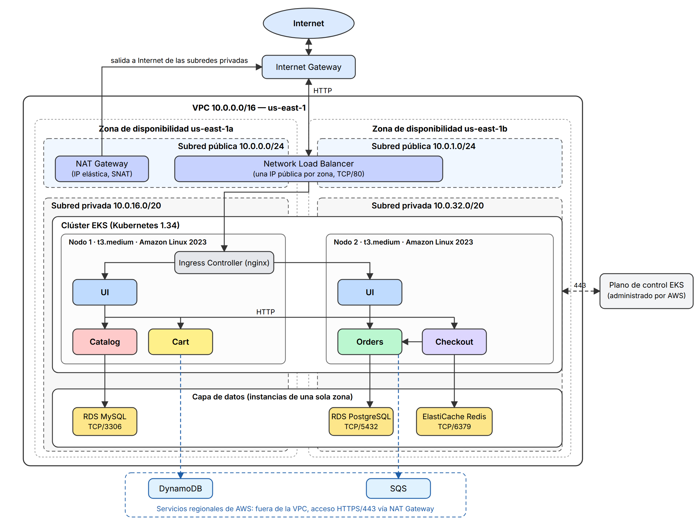

# Trabajo Práctico Especial

**Redes de Información – ITBA – segundo cuatrimestre de 2026**

## Gestión de infraestructura por código con Terraform, aplicada a The Store

**Pre-entrega**

Integrantes: Matias Rossi, Juan Pablo Birsa, Federico Viera

> Copia editable en Markdown del documento de pre-entrega. La versión que se
> entrega es `preentrega.pdf`, generada a partir de `preentrega.tex`. Si se
> cambia algo acá, replicarlo en el `.tex` y recompilar
> (`xelatex preentrega.tex`, dos veces).

**Resumen.** Se propone reemplazar el despliegue manual de The Store por una
definición declarativa en Terraform que crea, modifica y destruye en AWS toda
la infraestructura de la tienda: la red (VPC, subredes públicas y privadas,
ruteo y NAT), un clúster EKS con sus nodos, el balanceador de entrada, los
repositorios de imágenes, las bases de datos administradas y los objetos de
Kubernetes de la aplicación. El documento describe el diseño, el alcance de la
prueba de concepto con cuatro casos de uso, la arquitectura de red con su
direccionamiento y sus protocolos, y las alternativas evaluadas.

## 1. Problemática y contexto

The Store es la aplicación de referencia de la cátedra: una tienda en línea en
la que un usuario recorre el catálogo, arma un carrito y confirma una compra.
Está construida como cinco microservicios independientes —UI (Java), Catalog
(Go), Cart (Java), Orders (Java) y Checkout (Node.js)— que se comunican por HTTP
y dependen, respectivamente, de una base MySQL, una tabla DynamoDB, una base
PostgreSQL con una cola de mensajes y una caché Redis. Hoy se levanta con
`local.sh`, un script de bash que crea un clúster kind en la máquina del
desarrollador, compila las imágenes, las carga y aplica un manifiesto YAML con
todos los objetos.

Para desarrollar alcanza, pero como forma de operar un entorno real tiene un
límite estructural: es una receta de pasos, no una descripción del resultado.
Nada registra qué se creó, así que sólo se puede rehacer todo o borrar todo; un
cambio hecho con `kubectl` queda invisible; no hay manera de anticipar el
efecto de una modificación antes de ejecutarla; y cada variante del entorno
exige editar el script. Llevar la tienda a la nube multiplica el problema: se
suman redes, subredes, tablas de ruteo, clústeres, balanceadores, bases de
datos y reglas de filtrado que, creados a mano desde una consola, nadie puede
reproducir ni auditar con exactitud; cada entorno termina siendo una pieza
única que depende de la memoria de quien la armó (el *snowflake server* que
describe Fowler).

La respuesta de la industria es la infraestructura como código: describir en
archivos versionados el estado deseado y dejar que una herramienta calcule y
ejecute los cambios necesarios para alcanzarlo. Este trabajo aplica esa idea
con Terraform para que toda la infraestructura de The Store en AWS —desde la
VPC hasta los pods— se cree, se modifique y se elimine a partir de un único
conjunto de archivos.

## 2. Diseño de la solución

La solución es un proyecto Terraform (lenguaje HCL) que con un solo
`terraform apply` deja la tienda funcionando en la región `us-east-1` de AWS y
con un `terraform destroy` la elimina sin dejar rastro. Intervienen cinco
providers: `aws` para todos los recursos de la nube; `kubernetes` y `helm` para
lo que corre dentro del clúster; `docker` para construir las imágenes de los
microservicios en la máquina y publicarlas en el registro de contenedores de
AWS (ECR); y `random` para generar las contraseñas de las bases, que así nunca
aparecen escritas en el código.

La red (VPC, subredes, gateways y tablas de ruteo) se declara recurso por
recurso, de modo que cada componente quede explícito en el código; para el
clúster se usa el módulo comunitario `terraform-aws-modules/eks`, que encapsula
los roles de IAM y los security groups que EKS requiere. El código sigue la
estructura estándar de
HashiCorp [1]: una configuración raíz (`main.tf`, `variables.tf`, `outputs.tf`,
`providers.tf`, `backend.tf` y los valores concretos en `terraform.tfvars`) que
compone cinco módulos propios:

- **Red** (`modules/red`): VPC 10.0.0.0/16 sobre dos zonas de disponibilidad
  (`us-east-1a` y `us-east-1b`, el mínimo que exigen EKS y RDS); en cada una,
  una subred pública (10.0.0.0/24 y
  10.0.1.0/24) para el balanceador y el NAT Gateway y una privada (10.0.16.0/20
  y 10.0.32.0/20) para nodos, pods y bases; Internet Gateway, un NAT Gateway y
  una tabla de ruteo por tipo de subred.
- **Clúster** (`modules/cluster`): EKS con Kubernetes 1.34, dos nodos
  `t3.medium` (Amazon Linux 2023) administrados en las subredes privadas, uno
  por zona, bloque de Services 172.20.0.0/16, plugin de red VPC CNI con NetworkPolicies
  activas y el Ingress Controller nginx publicado por un Network Load Balancer
  en las subredes públicas, única puerta de entrada.
- **Imágenes** (`modules/imagenes`): un repositorio ECR por microservicio;
  Terraform construye las cinco imágenes a partir del código fuente de la
  cátedra y las publica con el tag que fija la variable `app_version`.
- **Datos** (`modules/datos`): RDS MySQL (Catalog), RDS PostgreSQL (Orders),
  ElastiCache Redis (Checkout), una tabla DynamoDB (Cart) y una cola SQS
  (Orders). RDS y ElastiCache quedan en las subredes privadas detrás de un
  security group que sólo admite conexiones de los nodos; DynamoDB y SQS se
  autorizan con una política IAM mínima sobre el rol de los nodos.
- **Aplicación** (`modules/aplicacion`): por cada microservicio, un Deployment
  (N réplicas) y un Service (nombre DNS interno con una IP virtual que reparte
  entre ellas); el Ingress que expone la UI; y cuatro NetworkPolicies que
  limitan el tráfico entre pods a lo necesario.

El estado de Terraform —el inventario de lo que existe— vive en un bucket S3
con versionado y bloqueo nativo (`use_lockfile`), creado una única vez con una
configuración auxiliar (`bootstrap/`): así los tres integrantes operan el mismo
entorno sin pisarse y cada `apply` queda registrado.

## 3. Scope del POC y casos de uso

**El POC incluye:** (i) la red completa descrita para el módulo `red`; (ii) el
clúster EKS con dos nodos, su Ingress Controller y el balanceador; (iii) la
construcción y publicación en ECR de las cinco imágenes; (iv) las cinco
dependencias de datos como servicios administrados, conectadas a los
microservicios; (v) el filtrado de tráfico con security groups y
NetworkPolicies bajo el principio de mínimo privilegio; (vi) el estado remoto
en S3; y (vii) la operación del ciclo completo: `terraform plan` antes de cada
cambio, `terraform apply` para crear y modificar, `terraform destroy` para
eliminar.

**Casos de uso.** Cada uno consiste en un cambio en `terraform.tfvars`, seguido
de `terraform plan` (para ver el alcance exacto) y `terraform apply`:

1. **Entorno reproducible y detección de desvíos.** Se crea todo desde cero con
   un `apply` y se elimina por completo con un `destroy`, comprobando que la
   cuenta queda sin recursos huérfanos. Luego se altera un objeto por fuera de
   Terraform (por ejemplo, se cambia con `kubectl` la cantidad de réplicas de
   un servicio): `terraform plan` expone la diferencia entre lo declarado y lo
   real (*drift*) y `terraform apply` la revierte, algo que el script original
   no puede hacer.

2. **Capacidad extra para una campaña de ventas.** Se anticipa un pico de
   tráfico. Se sube la UI de 2 a 4 réplicas y el clúster de 2 a 3 nodos
   editando dos valores. El plan muestra exactamente esos dos cambios; al
   aplicarlos, el grupo de nodos lanza una instancia EC2 nueva en las subredes
   privadas y Kubernetes distribuye las réplicas adicionales. Al terminar, se
   restauran los valores y el clúster se achica.

3. **Nueva versión de la aplicación y vuelta atrás.** Se corrige un defecto en
   el código de un microservicio y se incrementa `app_version`. Terraform
   reconstruye las imágenes, las publica en ECR con el nuevo tag y actualiza
   los Deployments; Kubernetes reemplaza los pods de a uno (*rolling update*),
   de modo que la tienda nunca deja de responder. Si la versión nueva resulta
   peor, basta con restaurar el valor anterior de la variable y aplicar de
   nuevo.

4. **Contención de un microservicio comprometido.** Se sospecha que Checkout
   fue vulnerado. Se lo agrega a la lista `quarantine`; el plan muestra un
   único cambio (la capa a la que pertenecen sus pods) y, aplicado, las
   NetworkPolicies le cortan toda comunicación: no recibe tráfico de la UI ni
   puede alcanzar a otros servicios, a las bases ni a Internet. Catálogo y
   carrito siguen funcionando; sólo la confirmación de compra queda fuera de
   servicio mientras se investiga. Vaciar la lista y aplicar restablece el
   servicio.

## 4. Diagrama de arquitectura

*Figura 1: Arquitectura del POC en AWS.*

La figura 1 muestra el entorno completo. El plan de direccionamiento es el
siguiente:

| Bloque | Ubicación | Aloja | Ruta por defecto |
|---|---|---|---|
| 10.0.0.0/16 | VPC, `us-east-1` | todo el entorno | — (ruta local entre subredes) |
| 10.0.0.0/24, 10.0.1.0/24 | subredes públicas, zonas a y b | NLB, NAT Gateway | Internet Gateway |
| 10.0.16.0/20, 10.0.32.0/20 | subredes privadas, zonas a y b | nodos EC2 y sus pods, RDS, ElastiCache | NAT Gateway (SNAT con una IP elástica) |
| 172.20.0.0/16 | virtual, dentro del clúster | IPs de los Services, traducidas por DNAT en cada nodo; CoreDNS en 172.20.0.10 | — |

Las subredes privadas son mucho más grandes que las públicas porque el plugin
VPC CNI de EKS asigna a cada pod una dirección de la subred del nodo, y porque
allí también viven las bases; las públicas sólo necesitan unas pocas
direcciones para el balanceador y el NAT. Los cuatro bloques son privados y
disjuntos. Los nombres de los servicios de AWS los resuelve el resolutor de la
VPC (10.0.0.2); los de los Services, CoreDNS.

Los nodos son instancias EC2 `t3.medium` con Amazon Linux 2023 (kubelet y
containerd), sin IP pública, en las subredes privadas y con un security group
propio; las imágenes de los microservicios también se basan en Amazon Linux
2023. El plano de control de EKS lo opera AWS fuera de la VPC y se alcanza por
HTTPS (443) con autenticación de IAM, tanto desde los nodos como desde las
estaciones de trabajo del grupo.

Están repartidos entre las dos zonas las subredes, el balanceador (un punto de
presencia por zona) y los nodos (uno por zona). Los microservicios corren con
una réplica —dos en la UI, una en cada nodo— y, si un nodo cae, Kubernetes los
vuelve a programar en el otro. RDS, ElastiCache y el NAT Gateway son de una sola
zona; DynamoDB, SQS y el plano de control de EKS son regionales.

Camino de un pedido: el navegador llega por el Internet Gateway al Network Load
Balancer, que balancea en capa 4 (TCP/80) hacia el puerto de nodo en el que
escucha el Ingress Controller; nginx enruta en capa 7 al Service de la UI, cuya
IP virtual se traduce por DNAT al puerto 8080 de uno de sus pods. Desde allí la
UI consulta por HTTP a los cuatro backends por su nombre DNS interno, y cada
backend a su almacenamiento con el protocolo del motor:

| Origen → destino | Protocolo / puerto | Quién lo controla |
|---|---|---|
| Internet → NLB → Ingress Controller | HTTP, TCP/80 → NodePort | security group de los nodos |
| Ingress Controller → UI; UI → backends; Checkout → Orders | HTTP, TCP/8080 (Service en 80) | NetworkPolicies |
| Catalog → RDS MySQL; Orders → RDS PostgreSQL; Checkout → ElastiCache | MySQL TCP/3306; PostgreSQL TCP/5432; RESP TCP/6379 | security group de datos: sólo desde los nodos |
| Cart → DynamoDB; Orders → SQS | HTTPS, TCP/443, vía NAT Gateway | política IAM del rol de los nodos |
| Nodos y estaciones → API server de EKS | HTTPS, TCP/443 | IAM y security group del clúster |

Dentro del clúster rige el mínimo privilegio: ningún pod acepta conexiones
entrantes salvo las que una NetworkPolicy permite; la UI, sólo desde el Ingress
Controller; los backends, sólo desde la UI y entre sí; un pod en cuarentena,
nada en ninguna dirección.

## 5. Alternativas consideradas

- **Pulumi y OpenTofu en lugar de Terraform.** Pulumi describe la
  infraestructura en TypeScript, Python o Go: el código mezcla lógica de
  programa con declaración de recursos y el plan de cambios es menos directo de
  revisar; HCL es declarativo y específico, con el ecosistema de providers más
  maduro. OpenTofu, la bifurcación abierta de Terraform, es compatible con este
  código; se mantiene Terraform por ser la herramienta del tema.
- **kind en lugar de EKS.** Fue el primer prototipo del grupo: gratuito y útil
  para validar el módulo de aplicación, pero no permite agregar nodos a un
  clúster existente, no tiene balanceadores ni bases administradas y su red es
  una simulación en una sola máquina. EKS permite mostrar escalamiento,
  servicios administrados y una red real.
- **El módulo comunitario de VPC en lugar de escribir la red.** Resuelve todo
  en diez líneas pero oculta las subredes, las tablas de ruteo y el NAT, que
  son el objeto de estudio; escribirlas a mano son quince recursos legibles.
  Con EKS se hace lo contrario, porque IAM no es el foco y es fácil
  equivocarse.
- **AWS Load Balancer Controller (ALB) en lugar de nginx con NLB.** Requiere
  instalar un controlador adicional con rol y política IAM propios. nginx con
  un NLB se instala con un chart, no necesita permisos extra y separa con
  claridad el balanceo de capa 4 del enrutamiento de capa 7.
- **IAM Roles for Service Accounts en lugar del rol de los nodos.** Es la
  práctica recomendada y queda anotada como mejora; para el POC agrega un
  proveedor OIDC y cinco roles sin cambiar lo que se demuestra.
- **Sólo Helm o Kustomize, o bien Ansible.** Helm y Kustomize alcanzan
  únicamente a los objetos de Kubernetes: no crean la VPC, el clúster ni las
  bases. Ansible configura servidores y no conserva un estado contra el cual
  detectar desvíos. Helm se usa igual, invocado desde Terraform, para instalar
  el Ingress Controller.

## 6. Referencias

1. HashiCorp. *Terraform documentation: What is Terraform?; Standard Module Structure*. https://developer.hashicorp.com/terraform/language/modules/develop/structure
2. Fowler, M. (2012). *SnowflakeServer*. https://martinfowler.com/bliki/SnowflakeServer.html
3. Morris, K. (2020). *Infrastructure as Code: Dynamic Systems for the Cloud Age* (2ª ed.). O'Reilly Media.
4. Amazon Web Services. *Amazon EKS User Guide: Networking*; *Amazon VPC User Guide*. https://docs.aws.amazon.com/eks/latest/userguide/eks-networking.html
5. terraform-aws-modules. *AWS EKS Terraform module*. https://github.com/terraform-aws-modules/terraform-aws-eks
6. Kubernetes. *Services, Load Balancing and Networking*; *Network Policies*. https://kubernetes.io/docs/concepts/services-networking/
7. AWS Containers. *Retail Store Sample Application*. https://github.com/aws-containers/retail-store-sample-app
